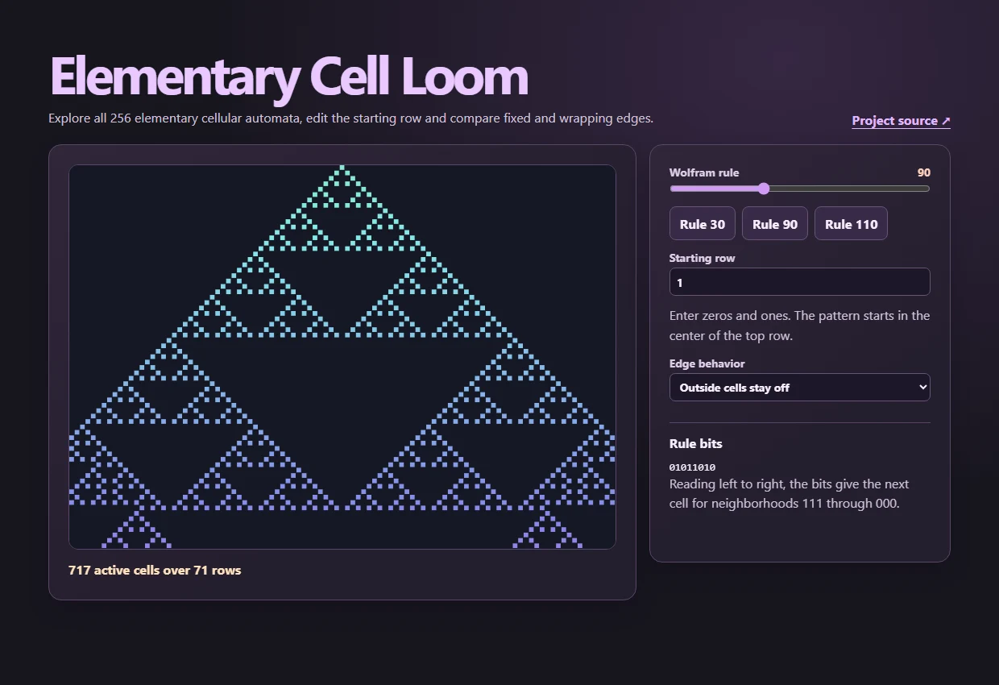

# Elementary Cell Loom

Explore all 256 elementary cellular automata, edit the starting row and compare fixed and wrapping edges.

[Open the browser app](https://surfingcoder.com/apps/elementary-cell-loom/)

## Run locally

Run the following command in this repository and open [localhost:8000](http://localhost:8000).

    python -m http.server 8000

Use the example rules or slide through all 256. Edit a binary seed of up to 101 cells and change the boundary to see how activity propagates. The top row is the initial state and each subsequent row advances the rule once.

## Verify

Run the following command with Node.js 22 or newer.

    node --test
